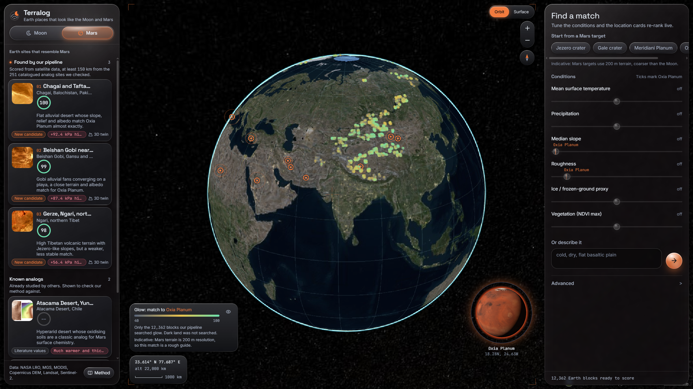
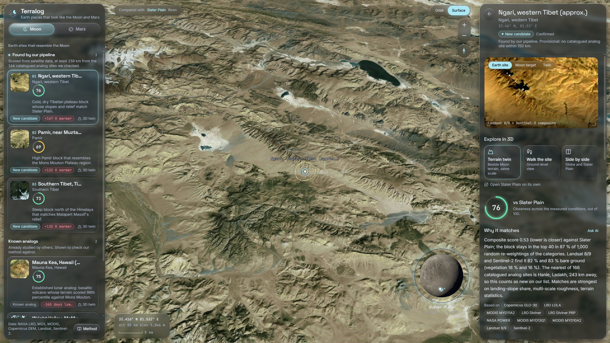
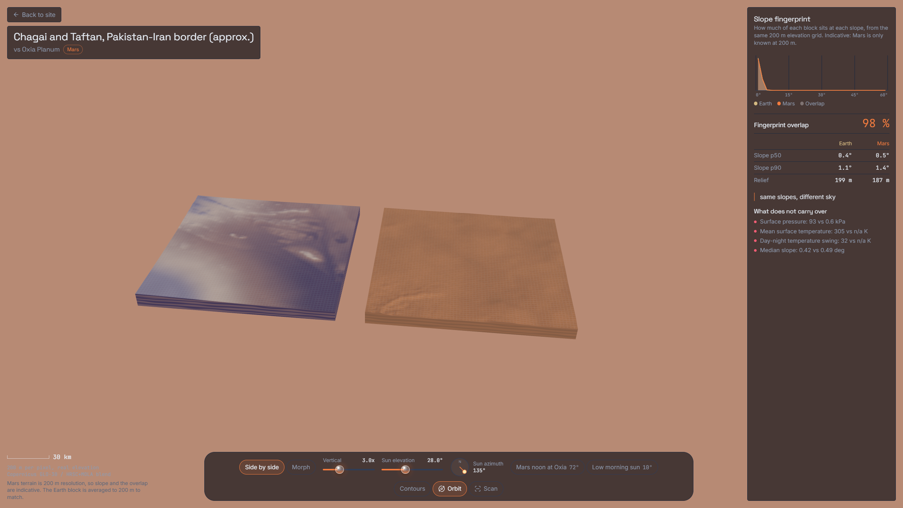

# Terralog

**Find places on Earth that look like the Moon and Mars.**

Terralog is a browser app and research pipeline built for the NASA Space Apps Challenge 2026 (Toronto), challenge "Permanent Moon Base Locations and Mars". It compares candidate Moon base regions and Mars landing sites with Earth terrain and climate, ranks the closest Earth matches, and lets you explore them on a globe, in a ground-level tour, and in a 3D side-by-side terrain lab.

<!-- Screenshots: add from docs/screenshots/readme-home-mars.png, readme-explore.png, readme-mars-lab.png -->

## Features

- **Globe of analog sites.** Pick Moon or Mars targets. Ranked cards show new candidates found by our pipeline and, separately, known analogs studied by others (used to check the method).
- **Heat field.** A glow over the Earth land blocks we searched, showing the match to the selected target.
- **Explainable matches.** Each site shows a match score, a per-feature comparison, a written reason it matches, and the gaps that remain (temperature, lighting, pressure).
- **Search.** Describe a place in plain language ("cold, dry, flat basaltic plain") or use sliders, importance weights and "must match" filters. Results re-rank live in the browser. A keyword parser is the fallback when the language model is unavailable.
- **Twin Terrain Lab.** An Earth block beside its Moon or Mars target at the same horizontal scale, with a slope fingerprint overlap, adjustable sun and vertical exaggeration.
- **Tour.** Fly over or walk a site on Cesium terrain or Google Photorealistic 3D Tiles, with an optional Moon or Mars colour grade.
- **Target Viewer and Compare.** A three.js heightmap of the target with a movable sun, and a side-by-side compare page.
- **Method page.** The scoring formula, features, datasets and limitations.

| Mars candidates on the globe | Site detail and "why it matches" |
|---|---|
|  |  |



More captures (mobile layout, tour, lunar-sun lab, morph view) are in [`docs/screenshots/`](docs/screenshots/).

## Findings

The discovery pipeline in `discovery/` scored 20 km blocks against the nine Artemis III south-pole regions (Moon) and 30 km blocks against four Mars sites (Jezero, Oxia Planum, Gale, Meridiani). Only places at least 150 km from any catalogued analog count as "new".

| Target | Candidate | Notes |
|---|---|---|
| Moon | Ngari, western Tibet | Best match to Slater Plain; surface confirmed bare with Landsat and Sentinel-2 |
| Moon | Pamir, near Muztagh Ata | Matches Mons Mouton Plateau; some sparse vegetation |
| Moon | Southern Tibet (Tingri/Dinggye) | Matches Malapert Massif; conditional, glacier in one corner |
| Mars | Chagai and Taftan, Pakistan-Iran border | Close to Oxia Planum in slope, relief and albedo |
| Mars | Beishan Gobi, Gansu-Mongolia border | Close to Oxia Planum |
| Mars | Gerze, northern Tibet | Wildcard, matches Jezero but less stable |

These are terrain and surface matches, not equivalence. No Earth block closes the Moon temperature or lighting gap, and none matches Mars pressure or thermal inertia. Mars terrain is only known at 200 m resolution, so Mars comparisons are indicative. A UI score is not proof of scientific equivalence. Place names are approximate, and "new" means only that nothing turned up in our catalogue and web searches. Details and caveats are in [`discovery/HANDOFF.md`](discovery/HANDOFF.md), [`discovery/FINDINGS.md`](discovery/FINDINGS.md) and [`discovery/mars/MARS_FINDINGS.md`](discovery/mars/MARS_FINDINGS.md).

## How scoring works

All scoring runs in the browser over precomputed Earth land cells (`public/data/earth_cells.json`). Sliders, the parser and the engine share twelve feature keys:

`slope_deg`, `roughness_m`, `relief_m`, `flat_frac`, `crater_density`, `shadow_frac`, `temp_mean_k`, `temp_max_k`, `ice_proxy`, `precip_mm_yr`, `vegetation_ndvi`, `snow_frac`

Each feature is normalised, compared with the target, and combined with user importance weights. Some features are one-sided (Earth is only penalised for being warmer than the Moon). See `src/scoring/` and the in-app Method page.

## Tech stack

Vite, React 19, TypeScript, Zustand, React Router, Tailwind CSS 4, Zod, Cesium, Three.js, Vitest. Serverless endpoints run on Vercel. The discovery pipeline is Python.

## Getting started

Requires Node 20.19 or newer.

```bash
npm install
cp .env.example .env   # optional, see below
npm run dev            # http://localhost:5173
```

The app works with no keys at all.

### Environment variables

| Name | Required | Where | Purpose |
|---|---|---|---|
| `CESIUM_ION_TOKEN` | Optional | Client, build time | Cesium World Terrain and Photorealistic 3D Tiles. Without it the globe uses NASA GIBS imagery and low-detail terrain. |
| `BACKBOARD_API_KEY` | Optional | Server only | Powers `/api/parse` (language search) and `/api/explain` ("why it matches"). Without it, search uses the keyword parser and explanations use curated text. |
| `LLM_NAME` | Optional | Server only | Model name for both endpoints. Defaults to `claude-sonnet-5-5`. |

The Backboard key is read only by the Vercel functions and the dev middleware in `vite.config.ts`, and never reaches the browser. Both endpoints validate input, rate limit, time out, and fall back gracefully.

### Scripts

| Command | What it does |
|---|---|
| `npm run dev` | Dev server, including `/api/parse` and `/api/explain` |
| `npm run typecheck` | TypeScript check |
| `npm test` | Vitest unit tests (scoring, parser, schemas, API cores, URL state) |
| `npm run build` | Type-check and production build to `dist/` |
| `npm run mock-data` | **Overwrites `public/data/` with synthetic data. Back it up first; normally never run.** |
| `npx tsx --env-file=.env scripts/compareModels.ts [models]` | Benchmark parser models |

## Data

The app reads generated files from `public/data/`, validated with Zod at startup: `targets.json`, `features.json`, `earth_cells.json`, `featured_analogs.json` and `heightmaps/`. The schema is in [`data/README.md`](data/README.md). A file with `"mock": true` in its provenance is synthetic, and the app shows a "Demo data" notice while one is loaded.

Rebuilding the data is a maintainer task that needs the Python discovery environment (`discovery/setup.sh`). Run the scripts in this order, and only on purpose, because the first one wipes the heightmap JSON that the second restores:

```bash
../discovery/.venv/bin/python scripts/build_real_data.py     # cards, targets, images, heightmaps
../discovery/.venv/bin/python scripts/build_twin_terrain.py  # Earth twins for the Twin Terrain Lab
```

Raw DEM tiles and Moon crops are not in git (`TERRALOG_TILES`, `TERRALOG_RAW`). The Mars twins read Copernicus tiles remotely from the open AWS bucket when no local tile exists.

## Deploying

A static Vite build plus two serverless functions, configured for Vercel in `vercel.json`. Set `BACKBOARD_API_KEY` and optionally `LLM_NAME` and `CESIUM_ION_TOKEN` (needed at build time) in the project settings. See [`docs/DEPLOY.md`](docs/DEPLOY.md).

## Project layout

```
api/                  Vercel functions: parse.ts, explain.ts (logic in api/_lib/)
src/scoring/          Pure scoring engine (no DOM or Cesium)
src/parse/            Keyword parser and API clients with fallback
src/data/             Zod schemas and loaders
src/globe/            Cesium viewer, pins, heat field
src/tour/             Tour controller, Target View, minimap
src/lab/              Twin Terrain Lab (three.js)
src/target/           Target Viewer and compare page
src/ui/, src/pages/   Panels, search, home and method pages
src/state/            Zustand store
public/data/          Generated data pack
scripts/              Data build scripts and model benchmark
discovery/            Python research pipeline, results and findings
docs/                 Product guide, design, deploy and QA notes, screenshots
```

## Further reading

- [`docs/Terralog_PRODUCT_GUIDE.md`](docs/Terralog_PRODUCT_GUIDE.md): product spec
- [`docs/DESIGN.md`](docs/DESIGN.md): design tokens and layout
- [`docs/DEPLOY.md`](docs/DEPLOY.md): deployment
- [`discovery/README.md`](discovery/README.md) and [`discovery/mars/README.md`](discovery/mars/README.md): pipeline

## Use of AI (Super Intelligence) tools

As required by the NASA Space Apps rules, we disclose where SI tools were used:

- **Code:** much of the web app (`src/`, `api/`) and the data scripts (`scripts/`, parts of `discovery/`) was written with an AI coding assistant (Anthropic Claude, via Claude Code) and reviewed, run and tested by the team.
- **Text:** site descriptions, "why it matches" paragraphs, the Method page and the demo slides were drafted with AI from our own results tables and checked by the team. The in-app "Ask AI" explanation is generated live and labelled as AI-written.
- **Data and findings:** all numbers come from the cited NASA and partner datasets, processed by our pipeline; none are AI-generated.
- **Images and video:** none are AI-generated. Screenshots are real captures of the app.

## Attributions

NASA PDS, LRO LOLA, Diviner and Mini-RF, Mars MOLA, THEMIS and TES, MODIS, Landsat; ESA Copernicus DEM GLO-30, Sentinel-2 and WorldCover; USGS HRSC+MOLA blended DEM and Artemis III region outlines; JAXA ALOS PALSAR-2; Cesium ion, NASA GIBS, Google Photorealistic 3D Tiles and Natural Earth. Terralog does not use Google Street View imagery.
